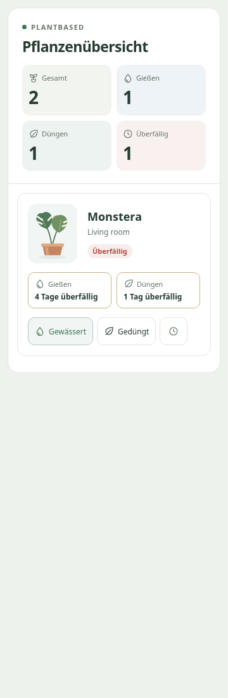
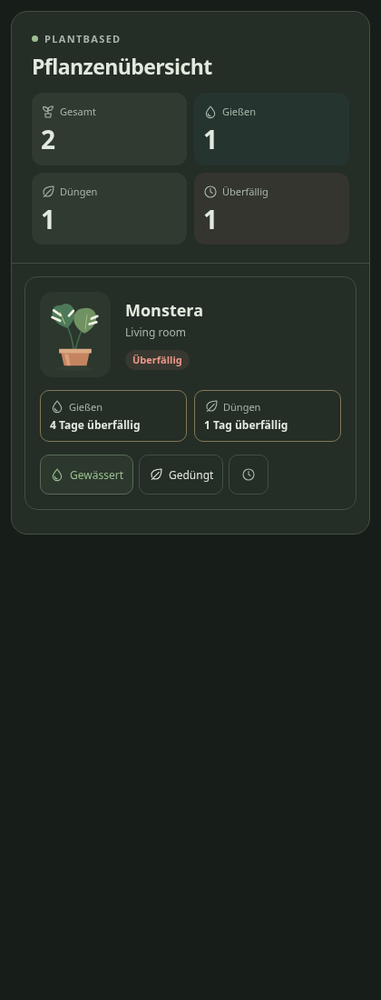

# PlantBased

Local, calendar-based houseplant care for Home Assistant. No plant sensors, cloud
accounts, or external Python requirements.

[](https://my.home-assistant.io/redirect/hacs_repository/?owner=Pyromania522&repository=PlantBased&category=integration)

**[Latest release](https://github.com/Pyromania522/PlantBased/releases/latest).**
Plants and groups have care controls, automation actions/events, a care calendar
and a task list. Optional reminders now send one grouped summary through selected
HA notifiers, with mobile care/snooze actions and an optional persistent HA copy.
Single-plant, group and overview cards now include English/German controls and
twelve original illustrations. The new sidebar page provides plant/group cards,
room grouping, live care status and direct plant/group creation. Automatic HA room
dashboards show three primary tiles per plant from v0.2.2.
See [release notes](docs/releases/v0.2.3.md)
and [GitHub Releases](https://github.com/Pyromania522/PlantBased/releases) for
published versions and installation assets.

Optional [adaptive watering](#adaptive-watering) learns each plant's recorded
watering rhythm locally, while retaining its manually configured base interval.

[Installation](#installation) · [Sidebar overview](#sidebar-overview) · [Cards](#dashboard-cards) ·
[Automations](#automation-examples) · [Reminders](#optional-reminders) ·
[Troubleshooting](#troubleshooting) · [Deutsch](#deutsch)

Field defaults and limits: [Configuration reference / Einstellungen](docs/CONFIGURATION.md).

## PlantBased in Home Assistant


PlantBased v0.2.0 running in Home Assistant (German, light theme). Screenshot
provided by the project owner. The **Add plant** and **Add group** buttons were
introduced in v0.2.1 and are not shown in this capture.

### Additional previews

[Desktop sidebar page](docs/images/panel-desktop.png) ·
[Groups](docs/images/panel-groups.png) · [Areas](docs/images/panel-areas.png) ·
[Mobile sidebar page](docs/images/panel-mobile.png)

 

These additional previews are Chromium captures of the compiled panel/cards with
demonstration data in the browser test fixture. HA setup/editor/calendar/Companion
screenshots remain
[documented capture placeholders](docs/images/README.md).

## Installation

Requires Home Assistant **2025.10.0 or later** and HACS for the HACS path. The HA
host needs no Node/npm build tools. This is an integration, not a separate HACS
frontend/card repository. The repository is added manually; it is not in HACS's
default catalog. The button below opens this custom repository in your HACS:

[](https://my.home-assistant.io/redirect/hacs_repository/?owner=Pyromania522&repository=PlantBased&category=integration)

If My Home Assistant asks for your instance URL, enter the address you normally
use to open HA. Confirm adding the repository, download PlantBased, restart HA,
then continue with step 3 below. The button requires HACS to be installed already.
It opens the repository; installation and HA restart still need your confirmation.

You can also add it manually:

1. In HACS, open the **⋮** menu → **Custom repositories** and add
   `https://github.com/Pyromania522/PlantBased` with category **Integration**.
2. Download PlantBased and restart Home Assistant.
3. Open **Settings → Devices & services → Add integration → PlantBased**.
4. Confirm the dialog. One PlantBased hub is allowed per installation.
5. On the integration card, choose **Add group** (optional) or **Add plant**.
   Give the plant a name, review the default care intervals and initial dates,
   and select a group if desired. **No group** keeps the plant independent.
   A group area takes precedence; the own area is a fallback.

For a manual release install, download `plantbased.zip` and `SHA256SUMS` from the
matching [GitHub Release](https://github.com/Pyromania522/PlantBased/releases),
run `sha256sum --check SHA256SUMS`, then extract the ZIP into the configuration's
`custom_components/` directory. The result must be
`custom_components/plantbased/manifest.json`, without another nested directory.
In HA Container this is usually `/config/custom_components/plantbased/` **inside
the container**; use the host directory mounted at `/config`. Restart the HA
container through your usual container manager, then continue with step 3.

Before the first public release, or when developing from source, copy the complete
repository directory `custom_components/plantbased` to that same destination.
The compiled frontend is already included; copying only Python files is insufficient.

Configuration is UI-only, without YAML or credentials. Plants and groups appear
as devices owned by native config subentries. Use **Reconfigure** on a subentry
to edit its settings; use the date entities to correct its last-care dates.
Reload or remove the hub from Devices & services. To uninstall, remove the hub
(which deletes its runtime history), uninstall through HACS, and restart HA.

Local brand images work on HA 2026.3+. Earlier versions may show a generic icon.

For the first plant, a name is enough: watering defaults to seven days,
fertilizing to 28 days, and initial care dates to today in HA's configured time
zone. Review those dates if the plant was cared for earlier. Groups, areas,
species, notes and images are optional. The group does not replace a plant's
individual intervals. Change group membership with the plant's **Reconfigure**
dialog. If a group has an HA area, its members inherit it. Otherwise plants use
their own areas. Own areas are kept as fallbacks when joining a group; leaving
the group or clearing its area restores them. Change a grouped plant's active
area through its group. Native HA device-area edits follow the same rule.

### Updates, backups and uninstall

Back up the HA configuration, including `.storage`, before updating. Select the
new version in HACS, download it and restart HA; refresh open browser/Companion
views to load the new card version. Keep the existing hub and subentries to retain
dates and history. Restore the HA configuration and storage together from a
known-good backup if recovery is needed; do not edit a live storage file.

To uninstall, remove PlantBased cards and any automations that reference its
devices/actions. Delete the hub in **Devices & services**, then remove the
download in HACS (or the manual `custom_components/plantbased` directory) and
restart HA. **Deleting the hub removes its care history and reminder receipts.**
Removing integration files alone does not remove the existing HA configuration.
Known mobile/persistent summaries are cleared on removal when their notifier is
available. Independently created automation messages must be dismissed separately.

## Sidebar overview

After setup, open **PlantBased** in HA's sidebar. The page is also available at
`/plantbased-dashboard`; no dashboard YAML or manual frontend resource is needed.

- **Plants:** every plant has a photo/illustration, live care status, watering and
  fertilizing countdowns, independent care/snooze buttons and its HA area.
- **Groups:** one card per group with member images and care counts. Expand
  **Show plants** for individual status/actions. Empty groups remain visible;
  unassigned plants appear under **No group**.
- **Areas:** plants are arranged under their current HA room, including **No area**.
  Area changes and renames update automatically.
- Search names, groups or rooms, or select **Care due only**. Paused/unavailable
  plants remain visible in the unfiltered view. Disconnected actions are disabled.
- Administrators can open **Settings** to add/reconfigure plants and groups or
  configure reminders, and use each card's device/group-details link.
- From v0.2.1, administrators can select **Add plant** or **Add group** directly on
  the overview. The dialog uses HA's existing fields, translated labels, defaults
  and validation. Canceling leaves the existing plants unchanged.

HA's native integration-management page keeps its standard device/subentry layout.
The sidebar page provides the visual care overview. If PlantBased is hidden, check
your HA profile's sidebar visibility settings. Removing/disabling the hub removes
the page; existing custom Lovelace cards remain supported.

## Care workflow

- **Mark watered / Mark fertilized** records today's local date and clears only
  that care timer's snooze. Editable date entities allow a past-date correction;
  last-care dates cannot be in the future.
- **Snooze** moves overdue care to tomorrow. Repeated presses add another day
  to the already postponed due date. Watering and fertilizing remain independent.
- **Pause plant / Vacation mode** suppress due flags and overview counts. The
  original dates keep running; overdue care reappears when unpaused. You can
  still record actual care while paused.
- Group buttons apply to **all members of that group**, including paused plants.
  Deleting a group unassigns its plants; deleting a plant removes its device,
  entities and runtime history.
- Intervals use local calendar days, not elapsed hours. State recalculates on
  changes, at local midnight, at HA start and on time-zone changes. No polling.
- Fertilizing defaults to March–September, inclusive. Seasons crossing New Year
  are supported. Outside the season, the next-fertilizing date shows the next
  season's first day; the interval is rechecked on that day. Disabled fertilizing
  has no due date. **All year** keeps the ordinary interval throughout the year.

Runtime dates, snoozes, pause/vacation state and the last 10 dates per care type
are stored in Home Assistant's private `.storage/plantbased.<entry_id>` file.
They survive hub reloads and HA restarts. Include HA's storage in your backups.
An unreadable store stops setup with a translated error instead of resetting
care dates. Restore it from a known-good backup before reloading.

PlantBased provides 16 entities per plant, five per group and eight on the hub. Care-status
attributes include group, species, image metadata, overdue days and history.
Calculated sensor entities do not require any physical sensor or sensor selection.
Image presets resolve to bundled original SVGs. Custom image paths/URLs are
loaded by the browser and are not downloaded by the backend.

| Device | Entities |
| --- | --- |
| Plant (16) | Four care/snooze buttons, two last-care dates, two interval numbers, two next-date sensors, two day countdowns, two due flags, care status, pause switch |
| Group (5) | Plant/watering/fertilizing counts and two group care buttons |
| Hub (8) | Four overview counts, any-care flag, vacation switch, calendar and to-do list |

Entity IDs are assigned by HA and can differ by name/language. Select devices or
entities from HA's pickers rather than copying an assumed entity ID. Disabling a
required care-status/count entity in HA makes the corresponding card unavailable.

## Adaptive watering

From v0.2.2, enable **Learn watering rhythm** when adding or reconfiguring a plant.
It is off by default. PlantBased learns only from new, undated **Watered**
confirmations, including group/card/to-do/reminder actions. The initial date and
old care history are not training data.

After three similar intervals (four separate watering dates), the active interval
can move one day toward your routine. For example, a four-day base interval becomes
three days after watering every three days consistently. Learning can shorten or
lengthen the rhythm. It uses the median of the last five eligible intervals and
requires three within one day or 20% of that median, whichever is greater.

Same-day confirmations add no samples. Explicit date corrections, snoozed intervals,
plant pauses and vacation periods interrupt observations. The already learned
interval survives pauses and restarts. Fertilizer timing remains independent.
All processing and storage stay local; this learns your recorded routine.

Cards show **Adaptive: N days** while enabled; the tooltip shows the number of
recorded intervals. Countdown, calendar, tasks and reminders use the active
interval. The watering number entity also shows the active interval; setting it
manually sets a new baseline and restarts learning, even when restoring the old
baseline. Changing the base interval in **Reconfigure** restarts learning too.
Turning learning off restores the configured baseline and clears observations.

## Dashboard cards

### Automatic Home Assistant room dashboards

From v0.2.2, the automatically generated room view shows three primary entities
per plant: **Care status**, **Days until watering** and **Days until fertilizing**.
Plant icons replace generic sensor icons. Additional due flags, action/snooze
buttons and last/next-care dates are hidden by default, while intervals and pause
remain configuration entities. All 16 entities remain enabled and usable by
PlantBased cards, automations and device controls.

The first upgrade to v0.2.2 also hides those additional entities for existing
plants. Previously hidden entities stay hidden. To show one again, open its
settings under **Settings → Devices & services → Entities** and enable **Visible**.
Later reloads/upgrades preserve that choice. Manually configured dashboards keep
their explicit cards. HA controls the generated room layout; use the PlantBased
cards below on an editable dashboard for images and combined care controls.

### PlantBased cards

After restarting HA and adding PlantBased, refresh an already-open browser tab.
The integration loads its card module automatically: **no manual dashboard
resource entry or separate frontend repository is needed**.

1. Open your dashboard, choose **Edit dashboard → Add card**, and search for
   **PlantBased**.
2. Choose **PlantBased** and select a PlantBased plant or group
   in the visual editor. A group displays its current members in a compact grid.
3. Add **PlantBased Overview / Übersicht** for hub counts and the list of due plants.
4. Optionally set a title or hide the action buttons in either editor.

Plant cards show watering/fertilizing countdowns, group names, and distinct
healthy, due, overdue, paused and unavailable states. **Watered**, **Fertilized**
and separate **Watering +1 day / Fertilizing +1 day** snooze choices use the existing
care actions. Buttons wait
for HA confirmation; failures show a message without marking care done. Care can
still be recorded during a pause. Disabled fertilizing has no enabled action.
The overview uses the hub's actual counters; pause/vacation plants stay out of its
due list. Entity and device renames do not require editing the card configuration.

These are optional dashboard YAML equivalents; integration setup stays UI-only:

```yaml
type: custom:plantbased-card
device_id: YOUR_PLANT_OR_GROUP_DEVICE_ID
title: Living room
show_actions: true
```

```yaml
type: custom:plantbased-overview-card
show_actions: true
```

`device_id` is the registry ID selected by the editor, not an entity ID. An empty
selection never targets all plants. `title` is optional; `show_actions` defaults
to `true`. Overview needs no device selection. Device/group membership updates and
care states arrive through HA's normal push connection, without polling.

Choose an illustration in the plant's **Reconfigure** dialog: generic, monstera,
ficus, pothos, snake plant, succulent, cactus, fern, orchid, herb, palm or hanging
plant. Alternatively use `/local/plants/your-photo.png` (a file under HA's
`www/plants/`) or an HTTP(S) image URL. A failed image falls back to the preset.
External images require browser access to that host; bundled presets work locally.
The cards follow the browser's HA language and theme, including dark mode and
narrow mobile/dashboard columns. Other languages fall back to English.

## Calendar, tasks and automation actions

The hub's **Care calendar** shows one all-day event for each plant's next open
watering/fertilizing date. An overdue task remains on its original date until
care is recorded or snoozed; repeated future care is not assumed. Paused plants
and global vacation are excluded. Outside the fertilizing season, the calendar
resolves the season-start marker against the actual interval before showing an
event. Thus a far-future interval does not create a premature calendar task.

The hub's **Plant care** to-do list contains currently due tasks only. Check an
item to record that care for today; dates, histories, counts and the calendar
update together. Completed tasks leave the list and remain in the plant's
history. Rename, manual task creation/deletion and due-date edits are unavailable;
edit the plant's settings/date entities instead. Refresh a stale task list before
completing a task from an older care cycle.

Four actions are available under **Developer tools → Actions**:

| Action | Fields | Targets |
| --- | --- | --- |
| `plantbased.mark_watered` | Optional `date`, defaults to today | Plant/group devices or their entities |
| `plantbased.mark_fertilized` | Optional `date`, defaults to today | Plant/group devices or their entities |
| `plantbased.snooze` | `care_type`: `water`/`fertilize`; `days`: 1–365, default 1 | Plant/group devices or their entities |
| `plantbased.set_interval` | `care_type`: `water`/`fertilize`; `days`: 1–365 | Plant/group devices or their entities |

Group targets expand to their current members, including paused plants. Multiple
references to the same plant act only once. Area/label targeting is supported;
`entity_id: all` explicitly selects every PlantBased plant. A missing target does
not select all plants. Hub targets are not plant/group targets. Invalid direct
targets fail before any plant changes. Bulk marks/snoozes save as one transaction.
Future care dates and fractional day counts are rejected.

The events `plantbased_care_due` and `plantbased_care_done` contain `device_id`,
`name` and `care_type` (`water` or `fertilize`). Due events fire on transitions to
due, including season entry, unpause and startup/reload for already-due care.
They do not repeat every overdue day. Done events fire after a successful save,
including care recorded through buttons, date entities, actions and to-do items.
Use these events as automation triggers independently of the optional reminders.

## Automation examples

The [tested YAML examples](docs/examples/README.md) can be pasted into separate
automations using HA's **Edit in YAML** UI. Integration configuration remains
UI-only. Examples include a persistent message on `plantbased_care_due`, clearing
the matching message on `plantbased_care_done`, and manually recording watering
for a selected group's actual members.

For quick action calls, select a PlantBased plant/group in **Developer tools →
Actions**. The example IDs are placeholders; use the visual target picker. Never
automatically mark care done merely because it becomes due. Daily summary
reminders are built in and do not need an automation.

Download **Diagnostics** from the integration entry menu to inspect care state.
The integration's payload includes plant names, dates, histories and care settings;
it excludes notes, species, group names, areas, location notes and image paths/URLs.
Calendar/task text follows HA's configured language; entity and action names are
translated by Home Assistant.

## Optional reminders

Open **Configure** on the PlantBased hub under **Settings → Devices & services**.
Reminders are **off by default**. Enable them and choose available notification
targets, or enable the persistent HA notification. The default reminder time is
**09:00 in Home Assistant's configured time zone**, with daily repeat enabled.
Select the `notify.mobile_app_*` service for Companion app action buttons.
New-style notify entities are also selectable for ordinary message/title delivery.

At the chosen time, one summary per selected target lists due plants under
watering and fertilizing headings. Paused/vacation work and out-of-season or
disabled fertilizing are excluded. English/German text follows HA's configured
language, with English fallback for other languages. You can choose:

- **Repeat daily while care is due**: otherwise only a newly due care task causes
  another scheduled summary. The summary still lists all currently due tasks.
- **Also show a persistent notification**: keeps a matching summary in HA and
  dismisses it when nothing is due.
- **Include mobile Snooze 1 day action**: adds a third Companion button alongside
  **All watered** and **All fertilized**, when those care types are due.

Mobile actions affect the still-due tasks listed by that message. Healthy plants,
newer care cycles and paused plants are never marked by an old message. Snooze
postpones both listed care types in one saved operation. Mobile summaries use one
entry-specific tag, so changes replace the current message and finishing care
clears it. Persistent copies update/dismiss too. Turning off reminders, removing
a target or disabling/removing the hub attempts to clear known mobile/persistent
messages. Ordinary notifier messages cannot be recalled through their generic API.

If HA starts after the chosen time, today's unsent reminder is caught up. Private
versioned receipts in `.storage/plantbased.<entry_id>.reminders` avoid duplicate
scheduled sends on ordinary reload/restart and during the repeated DST hour.
A skipped DST clock time is shifted forward by the gap. Persistent copies are
restored after HA startup. Include the care and reminder stores in backups.

A provider accepting a service call does not guarantee phone delivery or clearing;
Companion permissions, connectivity and platform limits still apply. A crash
between delivery and receipt persistence can repeat a message; mobile tags replace
it. Target failures are isolated and never mark care done. PlantBased delegates
to configured HA notifiers and makes no notification network request itself.

## Troubleshooting

For missing mobile reminders, confirm the hub's reminder time, HA time zone and
selected `notify.mobile_app_*` target. From v0.2.3, failed delivery is retried every
five minutes during the same local day; each retry checks current due work.
Care already completed, snoozed or paused is excluded, and successful recipients
are not sent duplicate daily reminders. Summary updates after care stay quiet on
iPhone (passive, no foreground alert) as well as Android; scheduled reminders use
normal alerts and respect iOS Focus and Scheduled Summary settings.

If the problem persists, enable PlantBased debug logging from its integration
menu before the next reminder. Logs distinguish the local timer trigger, notifier
acceptance and summary updates without including target IDs or plant names.
Notifier acceptance does not prove that the phone displayed the push immediately.

| Symptom | Check |
| --- | --- |
| PlantBased missing from Add integration | Verify the directory contains `manifest.json`, restart HA after downloading, check minimum HA version and sanitized HA logs |
| PlantBased missing from the sidebar | Update to v0.2.0 or newer, restart HA, refresh the browser/app, confirm the hub is loaded, and check your profile's sidebar visibility. The page URL is `/plantbased-dashboard` |
| Custom card not found / not in picker | Confirm the hub loaded successfully, then refresh the open tab/app; reinstall the complete integration if JS is missing. No manual resource is needed |
| Empty or unavailable card | Select a PlantBased plant/group in the editor, check the device still exists and its entities are enabled/available, and restore the HA connection |
| Counts differ from the number of plants | Due counts exclude paused/vacation plants and disabled/out-of-season fertilizing; total still counts all plants |
| Care is due sooner/later than expected | Check HA's time zone, last-care date, interval, snooze, season and pause state; intervals use calendar days |
| No reminder | Reminders default off; choose an available target or persistent HA copy and check HA-local time. Only still-due work is included |
| Phone actions missing or no phone delivery | Select a `notify.mobile_app_*` service and check Companion permissions/connectivity; generic notify entities do not carry mobile action data |
| Custom picture fails | Put local files under HA's `www/` and reference `/local/`; remote images must be browser-accessible HTTP(S). The preset is the fallback |
| Setup reports unreadable storage | Stop and restore a known-good backup of the matching HA configuration/storage; PlantBased intentionally preserves corrupt data rather than resetting dates |

Home Assistant emits its standard warning for every unreviewed custom integration;
PlantBased does not suppress that warning. This repository does not claim an
official HA quality-scale tier. For a bug report, include HA/PlantBased versions,
steps to reproduce and sanitized logs via the [issue template](https://github.com/Pyromania522/PlantBased/issues/new/choose).
Diagnostics include plant names and care dates; review before sharing.

## Roadmap

| Milestone | Scope | Status |
| --- | --- | --- |
| M1 | HACS structure, hub, translations, validation | Implemented; GitHub CI verified |
| M2 | Plant/group subentries, storage, scheduling, entities | Implemented; see VALIDATION.md |
| M3 | Actions, events, calendar, to-do, diagnostics | Implemented; see VALIDATION.md |
| M4 | Summary and actionable notifications | Implemented; see VALIDATION.md |
| M5 | Lovelace cards, visual editors, illustrations | Implemented; see VALIDATION.md |
| M6 | Complete documentation and v0.1.0 release | Released; see GitHub Releases |

Versioned packages and checksums are available from GitHub Releases. See
[RELEASING.md](docs/RELEASING.md) for the checked package, tag and publication steps.
Physical sensors, species databases, weather, cloud sync and HACS default-list
submission are outside this version.

## Deutsch

PlantBased bietet lokale, kalenderbasierte Pflanzenpflege für Home Assistant.
Feuchtigkeits-, Licht- und Bodensensoren sowie Cloud-Dienste sind nicht vorgesehen.

**[Aktuelle Veröffentlichung](https://github.com/Pyromania522/PlantBased/releases/latest).** Pflanzen und Gruppen lassen sich über die Integrationskarte
hinzufügen. Jede Pflanze erhält eigene Gieß- und Düngetermine, Datums- und
Intervallfelder, Pflegeknöpfe und einen Pausenschalter. Pflegekalender,
Aufgabenliste, Automationsaktionen und Ereignisse sind verfügbar. Optionale
Sammelerinnerungen, mobile Pflegeaktionen und Dashboard-Karten mit zwölf eigenen
Pflanzenillustrationen sind enthalten.

Ab **v0.2.0** öffnet **PlantBased** in der linken Seitenleiste eine eigene
Pflanzenübersicht. Du kannst zwischen **Pflanzen**, **Gruppen** und **Bereichen**
wechseln. Jede Pflanzenkarte zeigt Bild/Illustration, Pflegestatus, Gieß- und
Düngetermine sowie Pflegeaktionen. Gruppenkarten enthalten Mitgliederbilder und
Pflegezähler; **Pflanzen anzeigen** klappt die einzelnen Karten auf. Pflanzen ohne
Gruppe oder Bereich und leere Gruppen werden berücksichtigt.

Die Suche findet Pflanzen, Gruppen und Räume. **Nur fällige Pflege** grenzt die
Ansicht ein. Über **Einstellungen** gelangen Administratoren zur Verwaltung von
Pflanzen, Gruppen und Erinnerungen. Die bisherige Integrationsverwaltung behält
das normale HA-Layout. Für die neue Seite ist kein manuelles Dashboard nötig.
Falls der Eintrag verborgen ist, die Seitenleisteneinstellungen im HA-Profil prüfen.

Ab **v0.2.1** gibt es direkt auf der Übersicht **Pflanze hinzufügen** und
**Gruppe hinzufügen** für Administratoren. Das Formular übernimmt die vorhandenen
HA-Felder, Übersetzungen und Standardwerte. Nach dem Anlegen aktualisiert sich die
Übersicht; beim Abbrechen wird keine Pflanze oder Gruppe erzeugt.

[](https://my.home-assistant.io/redirect/hacs_repository/?owner=Pyromania522&repository=PlantBased&category=integration)

Der Button öffnet PlantBased direkt in deiner HACS-Installation. Falls My Home
Assistant nach der Adresse deiner Instanz fragt, die gewohnte HA-Adresse eintragen.
Das Hinzufügen bestätigen, PlantBased herunterladen und HA neu starten. HACS muss
bereits installiert sein. Danach unter **Einstellungen → Geräte & Dienste →
Integration hinzufügen** nach **PlantBased** suchen.

Ohne Button: In HACS über **⋮ → Benutzerdefinierte Repositories** die oben genannte
Adresse als **Integration** hinzufügen, herunterladen und Home Assistant neu
starten. Unter **Einstellungen → Geräte & Dienste → Integration hinzufügen** nach
**PlantBased** suchen und bestätigen. Es ist genau ein Hub möglich; die
Einrichtung erfolgt ohne YAML, Konto oder Sensoren. Zum Entfernen den Hub unter
Geräte & Dienste löschen, in HACS deinstallieren und Home Assistant neu starten.

Bei manueller Installation das ZIP und `SHA256SUMS` aus dem passenden GitHub
Release herunterladen, die Prüfsumme kontrollieren und nach
`custom_components/` entpacken. Danach muss
`custom_components/plantbased/manifest.json` existieren. Im HA-Docker-Container
liegt dieses Verzeichnis normalerweise unter `/config/`; auf dem Host den dafür
eingebundenen Ordner verwenden. Der HA-Container muss anschließend neu starten.
Vor dem ersten öffentlichen Release lässt sich stattdessen der vollständige
Integrationsordner aus dem Repository kopieren. Node/npm sind auf dem HA-Host
nicht erforderlich.

Vor Updates die HA-Konfiguration einschließlich `.storage` sichern. Beim Update
den Hub behalten, die neue Version herunterladen, HA neu starten und offene
Browser-/App-Ansichten neu laden. **Beim Löschen des Hubs werden Pflegeverlauf
und Versandnachweise entfernt.** Zum vollständigen Entfernen auch Karten und
zugehörige Automationen löschen, die Integration in HACS deinstallieren und HA
neu starten. Für eine Wiederherstellung Konfiguration und Speicher gemeinsam aus
einer passenden Sicherung zurückholen.

Über **Pflanze hinzufügen** genügt zunächst ein Name; die Intervalle sind mit
sieben Tagen fürs Gießen und 28 Tagen fürs Düngen vorbelegt. Gruppen und Bereiche
sind optional. **Keine Gruppe** legt eine unabhängige Pflanze an. Hat eine Gruppe
einen Bereich, übernehmen ihre Pflanzen diesen. Ohne Gruppenbereich gilt der
eigene Bereich. Dieser bleibt als Rückfallwert gespeichert und wird nach dem
Entfernen aus der Gruppe oder dem Leeren des Gruppenbereichs wieder verwendet.
**Wässern** und **Düngen** tragen das heutige Datum ein. Mit den
Datumsentitäten lässt sich eine zurückliegende Pflege nachtragen. Ein Datum in
der Zukunft wird abgelehnt.

Die Düngesaison läuft standardmäßig von März bis einschließlich September.
Zeiträume über den Jahreswechsel und ganzjähriges Düngen sind ebenfalls möglich.
Außerhalb der Saison zeigt das nächste Düngetermin-Feld den Beginn der nächsten
Saison an; das Intervall wird an diesem Tag erneut geprüft.

**Pflanzenpflege pausieren** und der globale **Urlaubsmodus** unterdrücken fällige
Pflege in den Statusanzeigen und Zählern. Die ursprünglichen Termine bleiben
erhalten und können nach dem Ausschalten sofort wieder überfällig sein.
Verschieben setzt bereits überfällige Pflege mindestens auf morgen; erneutes
Drücken verschiebt um einen weiteren Tag. Gruppenaktionen gelten nur für die
Mitglieder der gewählten Gruppe, auch für pausierte Pflanzen.

Beim Löschen einer Gruppe bleiben die Pflanzen erhalten und werden keiner Gruppe
mehr zugeordnet. Datumswerte, Verschiebungen, Pausen und die letzten zehn Einträge
je Pflegeart bleiben nach einem Neustart erhalten. Ein defekter Speicher wird nicht stillschweigend
zurückgesetzt; vor dem erneuten Laden muss eine Sicherung wiederhergestellt werden.

Der **Pflegekalender** am Hub zeigt den jeweils nächsten offenen Gieß- und
Düngetermin ganztägig. Überfällige Termine bleiben am ursprünglichen Datum;
weitere Wiederholungen werden erst nach erfasster Pflege berechnet. Pausierte
Pflanzen erscheinen weder im Kalender noch in der Aufgabenliste.

In der Aufgabenliste **Pflanzenpflege** genügt ein Häkchen: Die jeweilige Pflege
wird für heute gespeichert und die Aufgabe verschwindet. Der Verlauf bleibt
erhalten. Namen und Termine werden an der Pflanze bearbeitet. Ist eine Aufgabe
nicht mehr aktuell, die Liste vor dem Abhaken aktualisieren.

Unter **Entwicklerwerkzeuge → Aktionen** stehen `plantbased.mark_watered`,
`plantbased.mark_fertilized`, `plantbased.snooze` und `plantbased.set_interval`
zur Verfügung. Als Ziel Pflanzen- oder Gruppengeräte beziehungsweise deren
Entitäten wählen. Die Pflegeart lautet `water` oder `fertilize`, die Tageszahl
ist ganzzahlig zwischen 1 und 365. Gruppenaktionen ändern nur aktuelle Mitglieder;
mehrfach ausgewählte Pflanzen werden einmal bearbeitet.

Die Automationsereignisse `plantbased_care_due` und `plantbased_care_done` liefern
`device_id`, `name` und `care_type`. Fälligkeit wird beim Übergang gemeldet,
auch beim Start/Neuladen bereits fälliger Pflege; die Meldung wiederholt sich
nicht täglich. Erledigt-Ereignisse folgen erst nach erfolgreichem Speichern.
**Diagnosedaten herunterladen** im Menü des Integrationseintrags liefert
Pflegedaten mit Pflanzennamen, ohne Notizen, Standorte oder Bildadressen.

Erinnerungen sind zunächst **ausgeschaltet**. Unter **Einstellungen → Geräte &
Dienste → PlantBased → Konfigurieren** lassen sich Uhrzeit, Benachrichtigungsziele,
tägliche Wiederholung, eine zusätzliche HA-Meldung und die mobile Verschiebeaktion
festlegen. Standard ist **09:00 Uhr in der Home-Assistant-Zeitzone**. Mindestens
ein Ziel oder die zusätzliche HA-Meldung muss gewählt sein.

Für mobile Aktionsschaltflächen das Ziel `notify.mobile_app_*` wählen. **Alle
gewässert**, **Alle gedüngt** und optional **1 Tag verschieben** gelten nur für
noch fällige Aufgaben aus dieser Meldung. Alte Meldungen ändern keine späteren
Pflegezyklen. Neue Notify-Entitäten unterstützen einfache Nachrichten und Titel;
ihre derzeitige API bietet keine Aktions- oder Tag-Daten.

Ab **v0.2.3** werden fehlgeschlagene Zustellungen alle fünf Minuten bis zum Ende
des lokalen Tages erneut versucht. Dabei zählt nur noch fällige Pflege. Bereits
erfolgreiche Empfänger erhalten keine doppelte Tagesmeldung. Aktualisierungen
nach Pflegeaktionen bleiben auch auf dem iPhone still; planmäßige Erinnerungen
respektieren weiterhin Fokus und geplante Mitteilungsübersichten in iOS.

Mobile Sammelmeldungen werden unter demselben Tag aktualisiert und nach erledigter
Pflege zurückgezogen; die zusätzliche HA-Meldung wird ebenfalls aktualisiert oder
entfernt. Andere Benachrichtigungsanbieter können bereits versendete Nachrichten
nicht allgemein zurückrufen. Ist HA zur Erinnerungszeit ausgeschaltet, wird eine
heute noch nicht versendete Meldung nach dem Start nachgeholt. Versandnachweise
bleiben bei Neustarts erhalten; eine doppelte Uhrzeit bei der Zeitumstellung führt
nicht zu einer zweiten Tagesmeldung. Geräteverbindung, App-Berechtigungen und
Anbietergrenzen bestimmen die tatsächliche Zustellung.

### Gießrhythmus lernen

Ab **v0.2.2** lässt sich beim Anlegen oder unter **Neu konfigurieren** an der Pflanze
**Gießrhythmus lernen** einschalten. Standardmäßig ist es aus. Nach drei ähnlichen
Abständen zwischen vier neuen Gießbestätigungen passt sich das aktive Intervall
um höchstens einen Tag je Bestätigung an. Bei Basis vier Tagen und regelmäßigem
Gießen alle drei Tage wird daraus beispielsweise ein Rhythmus von drei Tagen.
Die Anpassung funktioniert auch zu längeren Intervallen.

Die Karte zeigt **Lernend: N Tage**. Kalender, Aufgaben und Erinnerungen folgen
diesem aktiven Intervall. Doppelte Bestätigungen am selben Tag, Datumskorrekturen,
verschobene Intervalle, Pausen und Urlaub fließen nicht ins Lernen ein. Alte
Pflegehistorien und das anfängliche Gießdatum werden nicht rückwirkend ausgewertet.
Der gelernte Rhythmus bleibt bei Neustarts und Pausen erhalten; alles bleibt lokal.

Das Basisintervall bleibt gespeichert. Lernen ausschalten stellt es wieder her.
Das Intervall über die Zahlenentität manuell setzen oder das Basisintervall unter
**Neu konfigurieren** ändern startet das Lernen neu. Düngeintervalle bleiben
unabhängig und werden nicht gelernt.

### Dashboard-Karten

Ab **v0.2.2** zeigt die automatisch erzeugte HA-Bereichsansicht je Pflanze nur
**Pflegestatus**, **Tage bis zum Gießen** und **Tage bis zum Düngen**, mit passenden
Pflanzensymbolen. Zusätzliche Fälligkeitsanzeigen, Aktions-/Verschiebeknöpfe und
Datumswerte werden standardmäßig ausgeblendet. Alle 16 Entitäten bleiben aktiv
und für PlantBased, Automationen und die Gerätesteuerung verfügbar.

Das erste Update auf v0.2.2 wendet diese Sichtbarkeit auch auf vorhandene Pflanzen
an. Bereits ausgeblendete Entitäten bleiben verborgen. Einzelne Entitäten lassen
sich unter **Einstellungen → Geräte & Dienste → Entitäten** in ihren Einstellungen
über **Sichtbar** wieder einblenden; diese Änderung bleibt bei späteren Neustarts
und Updates erhalten. Manuell angelegte Dashboard-Karten bleiben bestehen.
Das Layout der automatischen HA-Ansicht bestimmt Home Assistant. Für Pflanzenbilder
und Pflegeknöpfe in einer gemeinsamen Karte die PlantBased-Karten auf einem
bearbeitbaren Dashboard verwenden.

Nach dem HA-Neustart einen bereits geöffneten Browser-Tab neu laden. Die Karten
werden automatisch geladen; ein manueller Ressourceneintrag ist nicht nötig.
Unter **Dashboard bearbeiten → Karte hinzufügen** nach **PlantBased** suchen.
**PlantBased** bietet im visuellen Editor die Auswahl einer
Pflanze oder Gruppe. **PlantBased Overview / Übersicht** zeigt die Gesamtzahlen und alle
aktuell fälligen Pflanzen. Titel und Aktionsknöpfe lassen sich im Editor anpassen.

**Gewässert** und **Gedüngt** speichern die jeweilige Pflege. Unter
**Verschieben** lässt sich **Gießen +1 Tag** oder **Düngen +1 Tag** getrennt wählen. Während des
Speicherns sind doppelte Klicks gesperrt. Bei einem Fehler erscheint eine Meldung.
Pausen, überfällige Pflege und nicht verfügbare Pflanzen sind unterscheidbar.
Gruppenkarten folgen der aktuellen Zuordnung ihrer Pflanzen.

Unter **Neu konfigurieren** an der Pflanze eines von zwölf lokalen SVG-Motiven
wählen oder ein eigenes Bild wie `/local/plants/monstera.png` angeben. Die Datei
liegt dann unter `www/plants/` in der HA-Konfiguration. HTTP(S)-Bildadressen sind
ebenfalls möglich und werden vom Browser geladen. Ist das Bild nicht erreichbar,
erscheint das gewählte Motiv. Die Karten unterstützen Deutsch, Englisch,
HA-Themes, dunkle Darstellung und schmale Ansichten.

### Automationen und Hilfe

Die [Beispiele mit deutscher Anleitung](docs/examples/README.md#deutsch) zeigen
eine HA-Meldung bei fälliger Pflege, deren Entfernen nach gespeicherter Pflege
und eine manuell ausgeführte Gruppenaktion. Jede Datei im YAML-Editor einer
eigenen Automation einfügen. Beispiel-Geräte-IDs durch echte Ziele aus dem
visuellen Aktionseditor ersetzen. Tägliche Sammelerinnerungen sind bereits
eingebaut und benötigen keine Automation.

Fehlen Karten, zuerst prüfen, ob der Hub geladen ist, und den Browser/App-Inhalt
neu laden. Für eigene Bilder Dateien unter `www/` ablegen und `/local/` verwenden.
Bei unerwarteten Terminen die HA-Zeitzone, letzte Pflege, Saison, Pause und
Verschiebung prüfen. Erinnerungen sind anfangs aus; für mobile Aktionsknöpfe ein
`notify.mobile_app_*`-Ziel wählen. Ein defekter Speicher wird absichtlich nicht
überschrieben: eine passende Sicherung wiederherstellen.

Fehler bitte mit Versionsangaben, nachvollziehbaren Schritten und bereinigten
Logs über die [Issue-Vorlage](https://github.com/Pyromania522/PlantBased/issues/new/choose)
melden. Diagnosedaten enthalten Pflanzennamen und Pflegedaten. Die normale
HA-Warnung für benutzerdefinierte Integrationen wird nicht unterdrückt. Das Hauptbild
oben zeigt PlantBased in Home Assistant; die zusätzlichen Vorschauen stammen aus
dem Browsertest. Weitere geplante Aufnahmen sind als
[Platzhalter](docs/images/README.md) dokumentiert.

## Development and license

See [CONTRIBUTING.md](CONTRIBUTING.md), [DECISIONS.md](DECISIONS.md), and
[VALIDATION.md](VALIDATION.md). The [quality-scale self-review](docs/QUALITY.md)
documents applicable rules and manual acceptance limits.
Code and original artwork use the [MIT License](LICENSE).
